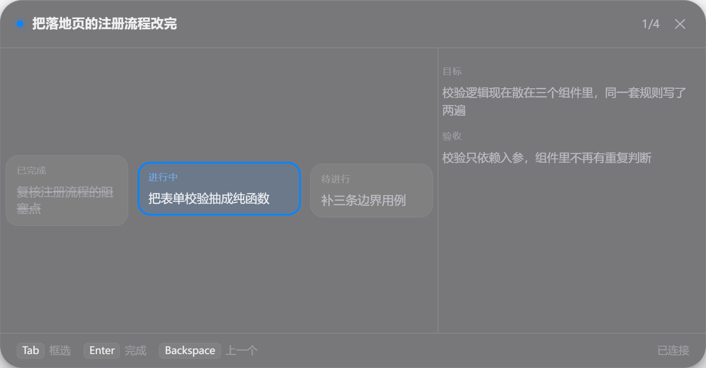

# DSH Work

> 让人类与 AI 共享同一个任务进程。

DSH Work 是 [DeepSeek Harness](https://github.com/deepseek-ai/deepseek-harness) 的一款插件。装上它，桌面顶部会多出一条极窄的半透明玻璃条；按一下键，它看见你的屏幕，把你嘴里那句「我想做点什么」切成可执行的节点，然后**人往前走一步，它在旁边递工具、提建议、必要时自己上手**。

它不是又一个待办清单。它的定位是**办公专注模式**：你在做什么、做到哪儿、下一步该干嘛、这件事该不该交出去——这些本该由人脑维持的状态，现在有一个常驻进程替你维持着，并且它有心跳。

> **要改它、或者要跟它一起工作？** 先读 [项目说明](docs/GUIDE.md)：它写清了项目是什么、每层为什么存在、各自负责什么、工程规则是什么、踩过哪些坑。
> 只想知道现在做到哪了，读 [接力板](docs/NEXT.md)。

```
┌──────────────────────────────────────────────────────────┐
│  伴随层（C++ / Win32，Electron 版保留可回退）                  │
│  热键 · 截图框选 · 置顶玻璃小条 · 面板 · 托盘                  │
└───────────────▲──────────────────────┬───────────────────┘
                │        HTTP / SSE     │
┌───────────────┴──────────────────────▼───────────────────┐
│  插件宿主（Node）   任务状态机 · 持久化 · AI 编排 · 工具      │
└───────────────▲──────────────────────┬───────────────────┘
                │      同源 HTTP        │
┌───────────────┴──────────────────────▼───────────────────┐
│  DSH 窗口内（React）  工作台 · 任务树 · 建议流 · 学习模式      │
└──────────────────────────────────────────────────────────┘
```

## 现在什么状态

**P0 地基已完成**：三层骨架跑通并互相认得——宿主侧有可回放的任务状态机与持久化，窗口内有玻璃条，桌面上有一条真正置顶、跨应用的玻璃条。

<p align="center"></p>

**P1 进行中**：全局热键唤出**面板**（小条的展开态）——当前节点居中，左右是已完成与待进行；`Enter` 完成并前进、`Backspace` 退一步、`Tab` 进框选。框完即识别：PNG 交给宿主，视觉模型一次调用拆成带目标与验收的任务树，落盘后小条与面板同时看到它。

<p align="center"></p>

> 文档里的图都是 `node scripts/make-shots.mjs` 用**合成数据**渲染真实界面得来的，
> 不是桌面截图——仓库是公开的，桌面截图会把别人窗口里的东西一起带出去。

| 阶段 | 内容 | 状态 |
|---|---|---|
| P0 | 三层骨架 + 契约冻结 + `core` 状态机 + 置顶玻璃条 | ✅ |
| P1 | 热键 → 面板 → 框选截图 → 识别 → 任务树 → 卡片轮播 | 🚧 识别已接，轮播待做 |
| 原生切片一 | C++ 小条替代 Electron（318 KB vs 210 MB） | ✅ |
| 原生切片二 | 原生面板 + 托盘 | 🚧 进行中 |
| P2 | 建议流 · 交给 AI · 任务树编辑 | ⬜ |
| P3 | 玻璃与动效 · 多屏 · 离线 · 设置 | ⬜ |
| P4 | 学习模式 · 眼球追踪 · macOS | ⬜ |

## 设计原则

1. **协议优先**。三端只能通过 `docs/PROTOCOL.md` 通信；任何一端都可以被重写而不动其他两端。
2. **单一真相源**。任务状态只存在于插件宿主，伴随层与界面都是视图，不得自行改状态，只能提 `Intent`。
3. **事件日志即历史**。所有变更以只追加的 `journal.ndjson` 落盘，可回放、可审计、可撤销。
4. **克制**。理性克制的动效，遵循动画十二原则里的「预备、跟随、缓入缓出」，不追求炫技。
5. **可维护**。每个决策写进 `docs/ADR/`，每个包自带 README，代码注释解释「为什么」而非「是什么」。

## 开发

```bash
pnpm install
pnpm test        # 直接跑 .ts，无需构建（Node 22.18+ 原生类型擦除）
pnpm typecheck
pnpm build       # esbuild 打插件与客户端两个 bundle
node scripts/shot.mjs   # 用本机 Chrome 无头截图，肉眼验收界面
```

把插件挂进一个开发用 profile（不动你日常那个）：

```bash
dsh dshwork-dev --from-default-profile web     # 首次：建 profile
pnpm build                                     # 每次改完客户端都要重打
dsh --profile dshwork-dev --port 64001 --no-open
```

> 端口被上一次的进程占着时，`dsh` 起不来而日志里看不出原因。先按端口杀：
> `Get-NetTCPConnection -LocalPort 64001 -State Listen | % { Stop-Process -Id $_.OwningProcess -Force }`

伴随层（桌面置顶玻璃条）单独跑：

```bash
cd apps/companion && ./node_modules/electron/dist/electron.exe .
```

> 在 DSH 的终端里启动前必须 `Remove-Item Env:ELECTRON_RUN_AS_NODE` —— DSH 自己的
> 诊断环境会带上它，Electron 见到它会退化成纯 Node，窗口一个都不会出现。
> 排障看 `~/.dsh/dsh-work/companion.log`。

文档索引：[项目说明](docs/GUIDE.md) · [架构](docs/ARCHITECTURE.md) · [协议](docs/PROTOCOL.md) · [数据模型](docs/DATA-MODEL.md) · [设计系统](docs/DESIGN-SYSTEM.md) · [路线图](docs/ROADMAP.md) · [当前任务](docs/NEXT.md)

## 许可

[MIT](LICENSE) © 2026 liyangyu001-hue
